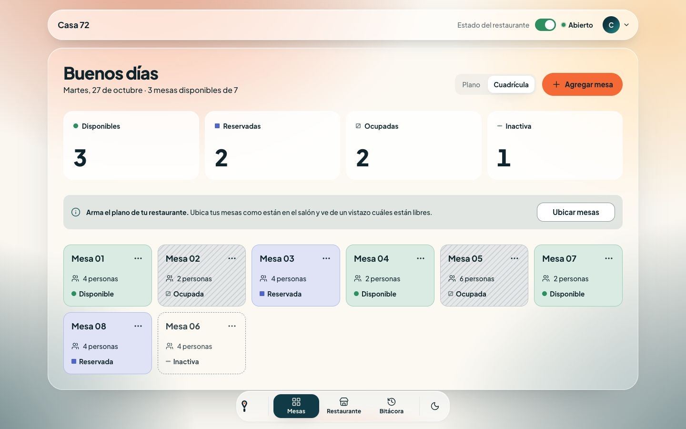
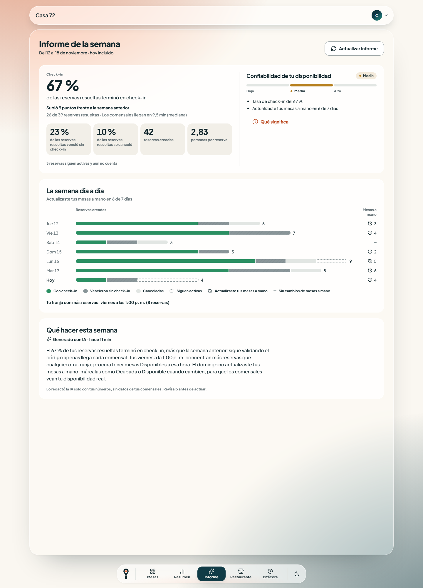
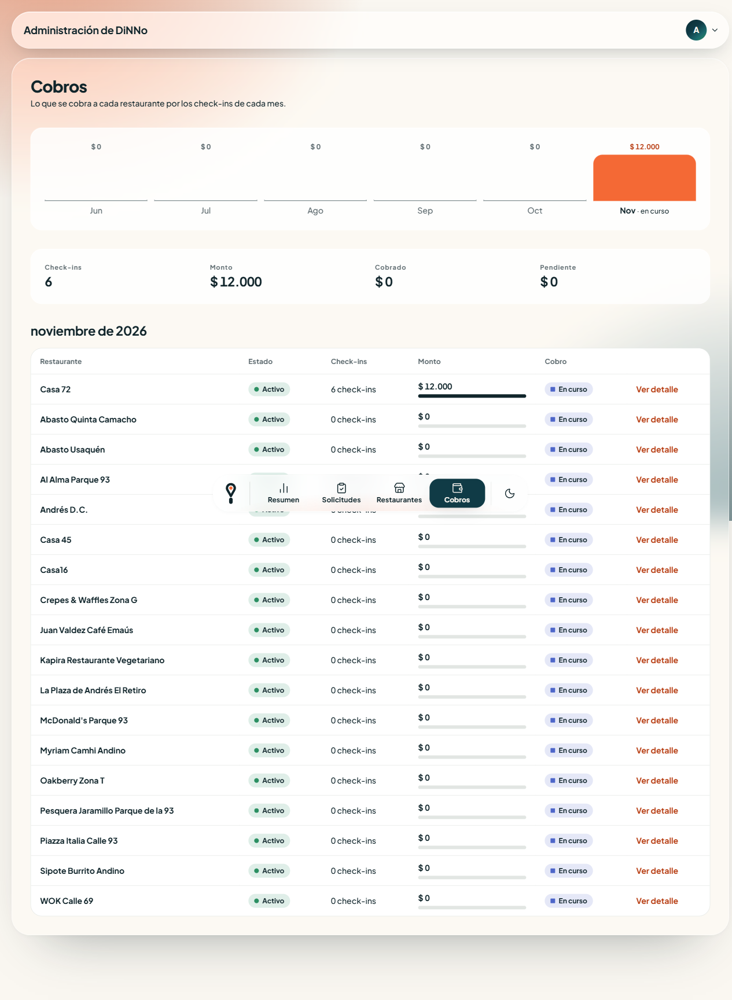
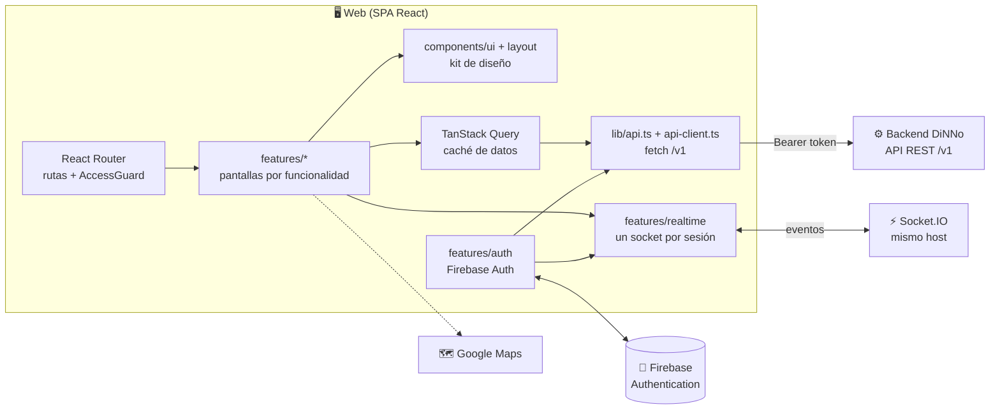
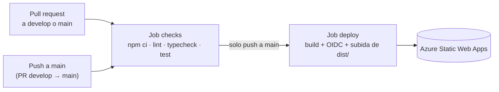

<div align="center">


# 📍 DiNNo · Frontend web

### **Dile no a la espera.**

Aplicación web de DiNNo para el **restaurante** (mesas, reservas, check-in, resumen e informe de IA) y para el **administrador de la plataforma** (solicitudes, restaurantes y cobros).

<br/>


</div>

---

## 📑 Tabla de contenido

| | | |
|---|---|---|
| [🍽️ Qué es DiNNo](#️-qué-es-dinno) | [🧩 Stack](#-stack) | [⚙️ Cómo funciona](#️-cómo-funciona) |
| [🗺️ Rutas y pantallas](#️-rutas-y-pantallas) | [🎨 Sistema de diseño](#-sistema-de-diseño) | [🚀 Empezar en local](#-empezar-en-local) |
| [📜 Scripts de npm](#-scripts-de-npm) | [📁 Estructura del proyecto](#-estructura-del-proyecto) | [✅ Pruebas y calidad](#-pruebas-y-calidad) |
| [☁️ Despliegue](#️-despliegue) | [👥 Equipo](#-equipo) | |

---

## 🍽️ Qué es DiNNo

DiNNo es un servicio de **microreservas de mesas** con disponibilidad inmediata: el comensal encuentra en la app móvil un restaurante con mesa disponible *ahora* y la asegura mientras llega. El restaurante administra sus mesas y confirma la llegada con un **check-in** desde esta web. Por cada comensal con check-in se cobra COP 1.500; el piloto es en la Calle 72, Bogotá.

Este repositorio es **la aplicación web**. Los otros dos están en la organización `DiNNo-team`:

| Repositorio | Qué es |
|---|---|
| **`frontend`** (este) | Web del restaurante y del administrador de la plataforma |
| [`backend`](https://github.com/DiNNo-team/backend) | API y tiempo real |
| [`mobile`](https://github.com/DiNNo-team/mobile) | App del comensal |

### 👤 Para quién es

| Rol | Qué hace en la web |
|---|---|
| **Administrador de restaurante** | Registra su restaurante, administra mesas y plano, abre y cierra el restaurante, valida el check-in, consulta reservas, bitácora, resumen y el informe semanal de IA |
| **Administrador de la plataforma** | Revisa solicitudes de registro (aprobar o rechazar), suspende y reactiva restaurantes, marca el cobro mensual y consulta métricas de la plataforma |
| **Comensal** | No usa la web: si entra con una cuenta de comensal ve una pantalla que lo dirige a la app |

### ✨ Funcionalidades principales

<details>
<summary><b>Restaurante</b></summary>

- **Mesas** (`/mesas`): vista en cuadrícula o **plano** por zonas, estados Disponible · Reservada · Ocupada · Inactiva, búsqueda y filtros, y cambio de estado con atajos de teclado.
- **Reservas DiNNo y check-in**: panel de reservas en curso con tiempo restante, y **Validar código** escribiéndolo, con **lector USB** o con la **cámara** (lectura de QR con jsQR). La web nunca muestra el código de una reserva.
- **Abierto / Cerrado**: interruptor en la barra superior, con aviso si hay reservas en curso.
- **Tiempo real**: las reservas nuevas, canceladas, vencidas o con check-in aparecen sin recargar.
- **Restaurante** (`/restaurante`): ver y editar datos, horarios y ubicación en un mapa de Google.
- **Bitácora** (`/bitacora`): historial de cambios de mesas con filtros y paginación.
- **Resumen** (`/resumen`): comensales, total a pagar a DiNNo, calendario de reservas, horas de mayor demanda y detalle del pago.
- **Informe semanal de IA**: ventana sobre el Resumen con cifras de la semana, confiabilidad y recomendaciones.
- **Registro público** (`/registro`) con verificación de correo y seguimiento de la **solicitud** de aprobación.

</details>

<details>
<summary><b>Administrador de la plataforma</b></summary>

- **Resumen**: ingresos por mes, mapa de calor de demanda y métricas de la plataforma.
- **Solicitudes**: aprobar o rechazar (con motivo) y suspender o reactivar restaurantes.
- **Restaurantes**: directorio con estado y detalle.
- **Cobros**: marcar un mes cerrado como cobrado o deshacerlo, con el detalle de check-ins por restaurante.

</details>

<div align="center">



*Mesas del restaurante: contadores por estado y tarjetas con color, forma y palabra.*

<br/>



*Informe semanal de IA sobre el Resumen del restaurante.*

<br/>



*Cobros del administrador de la plataforma (con datos de ejemplo).*

</div>

> [!NOTE]
> Las capturas son de documentos del repo (`docs/`) y pueden mostrar datos de ejemplo o una etapa anterior de la interfaz.

---

## 🧩 Stack

Versiones tomadas de `package.json` (rango) y de lo instalado.

| Tecnología | Versión | Para qué |
|---|---|---|
| [React](https://react.dev) | ^19.2 | Interfaz |
| [Vite](https://vite.dev) | ^8.3 | Servidor de desarrollo y build |
| [TypeScript](https://www.typescriptlang.org) | ~6.0 | Tipado estricto |
| [Tailwind CSS](https://tailwindcss.com) | ^4.3 | Estilos, con `@tailwindcss/vite` (sin `tailwind.config.js`) |
| [React Router](https://reactrouter.com) | ^8.4 | Rutas y carga diferida |
| [TanStack Query](https://tanstack.com/query) | ^5.104 | Datos del servidor y caché |
| [Firebase](https://firebase.google.com) (Authentication) | ^13 | Inicio de sesión (Google y correo con clave) |
| [socket.io-client](https://socket.io) | ^4.8 | Tiempo real |
| [Radix UI](https://www.radix-ui.com) (`radix-ui`) | ^1.6 | Comportamiento accesible sin estilos (diálogos, menús, select, switch, tooltip) |
| [lucide-react](https://lucide.dev) | ^1.52 | Íconos |
| [@vis.gl/react-google-maps](https://visgl.github.io/react-google-maps/) | ^1.10 | Mapa de ubicación del restaurante |
| [jsQR](https://github.com/cozmo/jsQR) | ^1.4 | Lectura del QR de check-in con la cámara |
| `clsx` + `tailwind-merge` | ^2.1 / ^3.7 | Clases condicionales (`cn`) |
| [@fontsource/plus-jakarta-sans](https://fontsource.org/fonts/plus-jakarta-sans) | ^5.3 | Tipografía |
| [Vitest](https://vitest.dev) + Testing Library + jsdom | ^5.0 | Pruebas |
| [oxlint](https://oxc.rs) | ^1.81 | Lint |

---

## ⚙️ Cómo funciona

### Arquitectura



### Piezas clave

| Tema | Cómo funciona |
|---|---|
| **Comunicación con el backend** | Toda llamada pasa por `apiFetch()` de [`src/lib/api.ts`](src/lib/api.ts), que une `VITE_API_URL` con el prefijo `/v1`. Los errores se traducen a textos en español con `getApiErrorMessage` e `isAccessError` ([`src/lib/api-client.ts`](src/lib/api-client.ts)); el texto técnico del backend no se muestra. |
| **Sesión** | Firebase Authentication entrega un token que se envía como `Authorization: Bearer`. El backend decide el rol; la web consulta `GET /v1/me` y `GET /v1/restaurants/me` para saber a dónde llevar a cada cuenta. |
| **Control de acceso** | `AccessGuard` ([`src/app/AccessGuard.tsx`](src/app/AccessGuard.tsx)) decide el destino según el estado de la cuenta (sin perfil, correo sin verificar, en revisión, rechazada, aprobada, suspendida, administrador o comensal). |
| **Estado del servidor** | TanStack Query, con la caché y los reintentos de [`src/app/query-client.ts`](src/app/query-client.ts); un error 4xx no se reintenta. No hay otra librería de estado global. |
| **Tiempo real** | [`useRestaurantRealtime`](src/features/realtime/use-restaurant-realtime.ts) abre **un solo socket** por sesión hacia el origen del backend. Escucha `reservation.created`, `reservation.cancelled`, `reservation.expired`, `reservation.checked_in` y `table.status_changed`, y actualiza la caché. Solo conecta con un restaurante aprobado; si falla, reintenta con espera creciente y el panel sigue consultando cada 30 s. |
| **Datos de ejemplo** | Con `VITE_USE_MOCKS=true` varias funcionalidades usan sus `api.mock.ts` en memoria, sin backend, y se controlan con parámetros de la URL (por ejemplo `?mockEmpty`, `?mockError=…`, `?mockLatency=…`; ver [`src/lib/mock-env.ts`](src/lib/mock-env.ts)). No entran al build de producción. |
| **Carga diferida** | Registro, solicitud, suspendido, Resumen y todo `/admin` se cargan bajo demanda. |

> [!IMPORTANT]
> Incluso con `VITE_USE_MOCKS=true` el inicio de sesión sigue usando Firebase, así que las tres variables `VITE_FIREBASE_*` son necesarias.

---

## 🗺️ Rutas y pantallas

Definidas en [`src/app/router.tsx`](src/app/router.tsx). La raíz `/` y cualquier ruta desconocida redirigen a `/mesas`, y el guardia reenvía a cada cuenta a su pantalla.

| Ruta | Quién la ve | Qué hace |
|---|---|---|
| `/login` | Cualquiera | Iniciar sesión con Google o correo y clave |
| `/registro` | Cuenta nueva (sin perfil) | Crear la cuenta, verificar el correo y enviar la solicitud del restaurante |
| `/onboarding` | Restaurante habilitado sin restaurante | Registrar el restaurante |
| `/solicitud` | Restaurante en revisión o rechazado | Ver lo enviado, editarlo, ver el motivo del rechazo y reenviar |
| `/mesas` | Restaurante aprobado | Mesas, plano, zonas, reservas DiNNo y «Validar código» |
| `/resumen` | Restaurante aprobado o suspendido | Resumen del periodo; `?informe=1` abre el informe semanal de IA |
| `/restaurante` | Restaurante aprobado | Ver y editar datos, horario y ubicación |
| `/bitacora` | Restaurante aprobado | Historial de cambios de mesas |
| `/suspendido` | Restaurante suspendido | Motivo, reservas con check-in y acceso al Resumen (solo lectura) |
| `/admin` | Administrador de la plataforma | Resumen de la plataforma |
| `/admin/solicitudes` | Administrador | Aprobar, rechazar, suspender y reactivar |
| `/admin/restaurantes` | Administrador | Directorio de restaurantes |
| `/admin/cobros` | Administrador | Cobro mensual por restaurante |
| `/admin/cobros/:restaurantId` | Administrador | Detalle del cobro de un restaurante |
| `/informe` | Restaurante aprobado | Redirige a `/resumen?informe=1` |
| `/kit` · `/sistema` | Solo con `npm run dev` | Catálogo del kit y vista previa del manual de identidad |

---

## 🎨 Sistema de diseño

La identidad visual está en el **manual de identidad v2.0** ([`docs/DiNNo_Manual_Identidad_v2_0.md`](docs/DiNNo_Manual_Identidad_v2_0.md)); la versión 1.1 ([`docs/DiNNo_Manual_Identidad_v1_1.md`](docs/DiNNo_Manual_Identidad_v1_1.md)) queda como histórico.

| Elemento | Decisión |
|---|---|
| **Paleta** | Petróleo `#103B46`, crema `#FAF7F1` y naranja `#F46935` (acción o «ahora») |
| **Tipografía** | Plus Jakarta Sans (500 / 700 / 800), vía `@fontsource` |
| **Íconos** | Lucide, a través del componente `Icon` (`src/lib/icon.tsx`) |
| **Modo claro y oscuro** | Claro por defecto; oscuro con `data-theme="dark"` en `<html>` (`useTheme()`). Los tokens cambian solos |
| **Estados** | Color + forma + palabra (nunca solo color), definidos en `STATUS_META` |
| **Superficies** | Fondo de luz del salón, hoja de vidrio y tarjetas; las de mesa son sólidas con su tinte |

### Cómo se aplica

| Pieza | Dónde |
|---|---|
| **Tokens del manual** | [`src/styles/tokens.css`](src/styles/tokens.css) (copia fiel del manual, no se edita) |
| **Mapeo a Tailwind** | [`src/styles/globals.css`](src/styles/globals.css) (`@theme inline` y utilidades propias) |
| **Kit de componentes** | [`src/components/ui`](src/components/ui) (botones, campos, tarjetas, chips de estado, diálogos, tablas, paginación…), con su [README](src/components/ui/README.md) |
| **Layout** | [`src/components/layout`](src/components/layout) (barra superior, hoja, dock de navegación, menú de usuario) |
| **Logo y marca** | [`src/assets/brand`](src/assets/brand) |
| **Catálogo visual** | `/kit` y `/sistema` al correr `npm run dev` |

Las pantallas se arman solo con el kit y con clases de tokens (`bg-surface`, `text-fg-2`, `rounded-card`…); no se usan colores sueltos, valores arbitrarios de Tailwind ni la paleta por defecto.

> [!TIP]
> `npm run check:ui` ([`scripts/check-ui.mjs`](scripts/check-ui.mjs)) revisa `src/` contra esas reglas: colores hex, `rgb()`/`hsl()`, valores arbitrarios, paleta y radios por defecto, íconos prohibidos, `console.log` y texto con opacidad. Sale con error y lista archivo, línea y columna.

<details>
<summary><b>Mockups y capturas del diseño</b></summary>

| Qué | Dónde |
|---|---|
| Mockups del manual v1.1 (logo, botones, campos, mesas, login…) | [`docs/mockups/`](docs/mockups) |
| Diagnóstico, registro e informe de la renovación v2 | [`docs/renovacion-v2/`](docs/renovacion-v2) |
| Capturas de la renovación (claro y oscuro, teléfono y escritorio) | [`docs/renovacion-v2/capturas-v2-1/`](docs/renovacion-v2/capturas-v2-1) |
| Diseño y capturas del informe de IA | [`docs/design/insights/`](docs/design/insights) |
| Diseño y capturas del panel del administrador | [`docs/design/admin-panel/`](docs/design/admin-panel) |
| Diseño y capturas del Resumen del restaurante | [`docs/design/restaurant-summary/`](docs/design/restaurant-summary) |
| Contratos de API de esas pantallas | [`docs/admin-panel-contract.md`](docs/admin-panel-contract.md) · [`docs/restaurant-summary-contract.md`](docs/restaurant-summary-contract.md) |
| Matrices de pruebas manuales por sprint | [`docs/qa/`](docs/qa) |

</details>

---

## 🚀 Empezar en local

### Requisitos

- **Node.js 24** (fijado en [`.nvmrc`](.nvmrc) y en `engines`). Con nvm: `nvm use`.
- **npm** (viene con Node).
- Un backend de DiNNo accesible (local o desplegado) **o** `VITE_USE_MOCKS=true` para trabajar con datos de ejemplo.
- Un proyecto de Firebase Authentication con los valores públicos de configuración.

### Pasos

```bash
git clone https://github.com/DiNNo-team/frontend.git
cd frontend
nvm use
npm ci
cp .env.example .env.local   # y completa los valores
npm run dev                  # http://localhost:5173
```

### 🔑 Variables de entorno

Se leen al iniciar `npm run dev`: si cambias una, reinicia el servidor. Todas las `VITE_*` terminan en el navegador.

| Variable | Obligatoria | Para qué |
|---|---|---|
| `VITE_API_URL` | Sí | Origen del backend, **sin `/v1` y sin `/` final** |
| `VITE_FIREBASE_API_KEY` | Sí | Configuración pública de Firebase Authentication |
| `VITE_FIREBASE_AUTH_DOMAIN` | Sí | Ídem |
| `VITE_FIREBASE_PROJECT_ID` | Sí | Ídem |
| `VITE_USE_MOCKS` | No | `true` usa datos de ejemplo en memoria |
| `VITE_GOOGLE_MAPS_API_KEY` | No | Mapa de la ubicación; sin ella el formulario funciona sin mapa |
| `VITE_GOOGLE_MAPS_MAP_ID` | No | Map ID de Google Maps (pin arrastrable y mapa oscuro) |

> [!WARNING]
> Los valores reales no van en el repositorio y **nunca se ponen secretos en variables `VITE_*`**: terminan dentro del sitio publicado. Consulta [`.env.example`](.env.example) para el detalle de cada una.

---

## 📜 Scripts de npm

| Script | Qué hace |
|---|---|
| `npm run dev` | Servidor de desarrollo con recarga en caliente (`http://localhost:5173`) |
| `npm run build` | Chequeo de tipos (`tsc -b`) y build de producción a `dist/` |
| `npm run preview` | Sirve el build de `dist/` |
| `npm run typecheck` | Solo el chequeo de tipos (`tsc -b`) |
| `npm run lint` | Lint con oxlint |
| `npm test` | Pruebas una sola vez (`vitest run`) |
| `npm run test:watch` | Pruebas en modo observación |
| `npm run check:ui` | Reglas del manual de identidad sobre `src/` |

---

## 📁 Estructura del proyecto

| Carpeta | Contenido |
|---|---|
| `src/app/` | Providers, router, `AccessGuard`, layouts y cliente de TanStack Query |
| `src/components/ui/` | Kit de componentes base y su README |
| `src/components/layout/` | Estructura común: barra superior, hoja, dock de navegación, menú de usuario |
| `src/features/` | Una carpeta por funcionalidad (ver abajo) |
| `src/lib/` | Utilidades compartidas: `api.ts`, `api-client.ts`, `format.ts`, `icon.tsx`, `theme.tsx`, `cn.ts`, `mock-env.ts` |
| `src/styles/` | `tokens.css` (manual) y `globals.css` (mapeo a Tailwind y utilidades) |
| `src/assets/` | Marca (logo, símbolo, favicon, íconos de app) y recursos de Google |
| `src/dev/` | Páginas `/kit` y `/sistema`, solo en desarrollo |
| `src/test/` | Configuración de Vitest y utilidades de prueba (socket simulado, render con providers) |
| `public/` | `staticwebapp.config.json` (se copia a `dist`) |
| `scripts/` | `check-ui.mjs` |
| `docs/` | Manuales de identidad, mockups, diseños, contratos de API y matrices de QA |
| `.github/workflows/` | CI/CD (`web-ci-cd.yml`) |

### `src/features/`

| Funcionalidad | Qué contiene |
|---|---|
| `auth` | Inicio de sesión y sesión con Firebase |
| `account` | Quién es la cuenta (`GET /v1/me`) y a dónde va (`useAccess`) |
| `signup` | Registro público y pantalla de la solicitud |
| `restaurant` | Registro y edición del restaurante, mapa y horarios |
| `restaurant-status` | Interruptor Abierto / Cerrado |
| `tables` | Mesas, plano, zonas, búsqueda y filtros |
| `reservations` | Reservas DiNNo y check-in (código, USB, cámara) |
| `activity-log` | Bitácora de mesas |
| `summary` | Resumen del restaurante |
| `insights` | Informe semanal de IA |
| `realtime` | Socket único con los eventos del restaurante |
| `suspended` | Pantalla del restaurante suspendido |
| `admin`, `admin-overview`, `admin-restaurants`, `admin-billing` | Panel del administrador de la plataforma |

**Patrón de cada funcionalidad:** `types.ts` (forma de los datos) → `api.ts` (llamadas, con `api.mock.ts` al lado) → `hooks.ts` (TanStack Query) → `components/` y la página. Los textos de interfaz viven en `messages.ts`.

> [!NOTE]
> El código (nombres, archivos, props, tipos) está en inglés; los textos de la interfaz, en español.

---

## ✅ Pruebas y calidad

| Herramienta | Comando | Qué revisa |
|---|---|---|
| Vitest + Testing Library | `npm test` | Componentes, páginas, hooks y lógica pura (jsdom) |
| oxlint | `npm run lint` | Errores y malas prácticas |
| TypeScript | `npm run typecheck` | Tipos estrictos |
| `check:ui` | `npm run check:ui` | Reglas del manual de identidad |
| Build | `npm run build` | Tipos + build de producción |

Última corrida local (23 nov 2026, Node 24): **823 pruebas en 82 archivos, todas pasan**; `npm run lint` y `npm run check:ui` sin problemas. El socket está simulado en todas las pruebas (`src/test/fake-socket.ts`), así que ninguna abre una conexión real.

---

## ☁️ Despliegue

La web se publica en **Azure Static Web Apps** (recurso `swa-dinno`). El flujo está en [`.github/workflows/web-ci-cd.yml`](.github/workflows/web-ci-cd.yml).



| Job | Cuándo corre | Qué hace |
|---|---|---|
| `checks` | Pull request a `develop` o `main`, push a `main` y ejecución manual | `npm ci`, `npm run lint`, `npm run typecheck`, `npm run test` (Node del `.nvmrc`) |
| `deploy` | Solo push o ejecución manual sobre **`main`**, después de `checks` | Verifica que `VITE_API_URL` sea `https://`, compila con `npm run build`, inicia sesión en Azure y sube `dist/` |

- **Rama que despliega: `main`.** El trabajo diario entra a `develop` por pull request, y `develop` pasa a `main` por otro.
- **Autenticación OIDC:** el job entra a Azure con una credencial federada (`azure/login`) sin guardar contraseñas ni llaves en GitHub; el token de despliegue se lee en ese momento con `az staticwebapp secrets list` y se oculta en el log.
- **Variables del repositorio:** los identificadores de Azure y los `VITE_*` del build son variables de GitHub, no secretos.

### `public/staticwebapp.config.json`

| Configuración | Efecto |
|---|---|
| `navigationFallback` | Cualquier ruta sirve `/index.html` (la SPA no da 404 al recargar), salvo `/assets/*` y archivos estáticos |
| Cabeceras de seguridad | `Strict-Transport-Security`, `X-Content-Type-Options: nosniff`, `X-Frame-Options: DENY`, `Referrer-Policy`, `Permissions-Policy` (cámara y geolocalización solo del propio sitio) y `Cross-Origin-Opener-Policy` |
| Caché | `/assets/*` con caché larga e inmutable; `/index.html` sin caché |

---

## 👥 Equipo

| Nombre | Rol en el proyecto | GitHub |
|---|---|---|
| Elizabeth Correa Suárez | Backend base y de mesas, edición del restaurante, integración y demo; revisión de backend | [@Eliza-05](https://github.com/Eliza-05) |
| Juan Sebastian Ortega Muñoz | Kit visual y pantallas de mesas, reservas y tiempo real; revisión de web y mobile | [@Juanseom](https://github.com/Juanseom) |
| Santiago Carmona | Registro del restaurante | [@Carmo0982](https://github.com/Carmo0982) |
| Jacobo Diaz | Autenticación y pantalla del restaurante | [@Jacobo2025](https://github.com/Jacobo2025) |
| Sergio Alejandro Idarraga Torres | Estado Abierto/Cerrado, bitácora e informe de IA | [@ALEJO21005](https://github.com/ALEJO21005) |

---

<div align="center">

**DiNNo** · *Dile no a la espera.* 🧡

</div>
